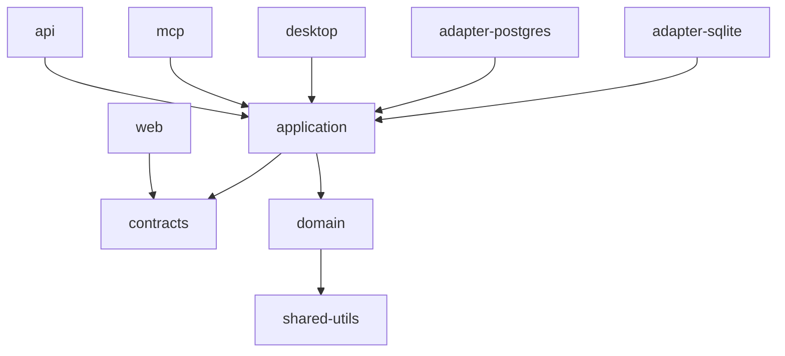
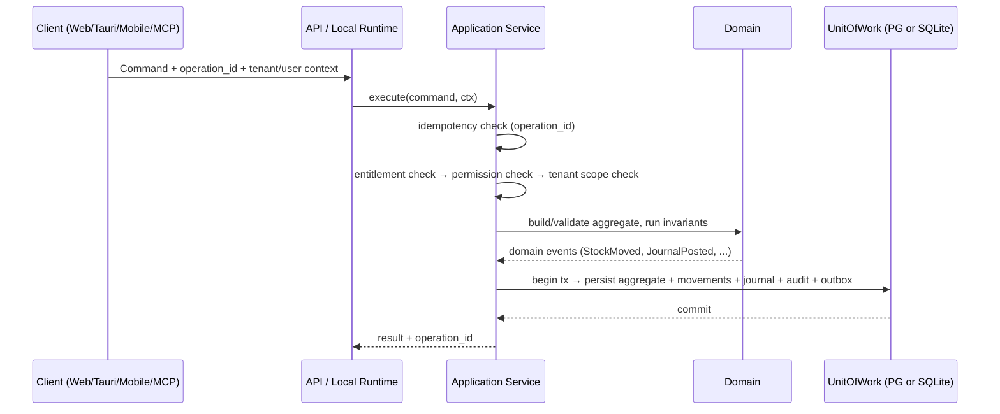

# 02 — Architecture Plan & Validation

## 1. Validation of the SRS Architecture

SherERP uses a modular monolith with `UI → Application → Domain → Repository/Infrastructure`. V1 is online-first with Drizzle + PostgreSQL. The repository boundary is designed now so the same Domain/Application business logic can later use Drizzle + SQLite for full offline support.

**Verdict: correct, but only survivable if the layering is physically enforced by package boundaries.** Logical layering inside one NestJS app will be violated by AI agents within weeks. Therefore layering = workspace packages + CI boundary checks.

## 2. Repository Layout

```text
shererp/
├── packages/
│   ├── core-domain/         # PURE TS. Entities, value objects, invariants, policies. No framework.
│   ├── core-application/    # Use cases (application services), ports, permission checks, audit emission
│   ├── core-contracts/      # zod schemas, DTOs, error codes, OpenAPI types, sync envelope types
│   ├── adapter-postgres/    # Drizzle + PostgreSQL repository implementations (V1)
│   ├── adapter-sqlite/      # Future Drizzle + SQLite repository implementations
│   └── shared-utils/        # Money, Qty, ULID, date/timezone, rounding
├── apps/
│   ├── api/                 # NestJS: HTTP, auth guards, DI wiring, OpenAPI, jobs
│   ├── web/                 # Vue 3 + Vite SPA
│   ├── desktop/             # Tauri 2 shell (Phase 12)
│   ├── mobile/              # Expo (Phase 13)
│   └── mcp/                 # MCP server (Phase 14)
└── docs/                    # This planning package + module specs
```

Dependency rule (CI-enforced, one direction only):



`core-domain` imports **nothing** except `shared-utils` and `zod`.

## 3. Layer Responsibilities

| Layer | Contains | Must NOT contain |
|---|---|---|
| `core-domain` | Entities, invariants (e.g. "a lot's remaining qty may never go below zero unless negative stock is enabled"), costing strategies, ledger posting rules, document state machines | SQL, HTTP, Nest, dates from `Date.now()` (clock is injected) |
| `core-application` | One class per use case (`CreateSaleService`), transaction boundary via `UnitOfWork` port, permission check, audit event emission, idempotency check | Raw SQL, framework decorators |
| `adapter-*` | Repository/UnitOfWork implementations, dialect specifics, locking | Business rules, validation of business meaning |
| `apps/api` | Controllers, guards, DTO→command mapping, OpenAPI, error mapping, jobs | Business rules (a controller is ≤ 20 lines) |

## 4. Canonical Write Path (identical online, offline and via MCP)



**Every financial/inventory command writes, in one transaction:** the document, its stock movements, its journal lines, the audit event, and (offline) the sync outbox record. No partial writes (SRS §43).

## 5. Posting Kernel (addresses gap C-01)

```text
Business Document (Sale / Purchase / Payment / Expense / Return / Adjustment)
        │
        ├─► Stock Movements (append-only, signed qty, lot-linked)
        ├─► Journal Entry  (balanced: Σ debit = Σ credit, internal)
        │        └─► Party Ledger / Cash / Bank / Expense views are PROJECTIONS of journal lines
        └─► Audit Event
```

- Internal accounts are system-managed (`AR`, `AP`, `CASH`, `BANK:{id}`, `INVENTORY`, `COGS`, `SALES`, `EXPENSE:{cat}`, `VENDOR_PAYABLE`, `ROUNDING`, `OPENING_EQUITY`).
- The **user never sees a chart of accounts in V1.** Ledgers/terminology (Debit/Credit, Cash In/Out, পাবো/দিব) are display mappings (SRS §27, §36) over the same signed journal lines.
- Balances (`party_balance`, `stock_balance`, `account_balance`) are **derived, recomputable tables**, never the source of truth. A nightly + on-demand `verify` job recomputes and reports drift.

## 6. Freedom-with-Integrity Mechanism (SRS §45)

| Authorized action | Implementation | Guarantee |
|---|---|---|
| Edit posted document | Create new version: reverse original postings + post new ones, same document id, `version+1` | Old numbers reproducible |
| Delete posted document | Void (reverse) + soft-delete flag; hard delete only if never posted | No orphan money |
| Change transaction date | Allowed within open period; `posting_date` changes, `created_at` immutable; flags `BACKDATED`/`LATE ENTRY` | Reports by transaction date, audit by created date (SRS §27) |
| Correct / reverse / cancel | Explicit reversal documents linked by `reverses_document_id` | Full trail |
| Backdate into reconciled/closed range | Requires `period.unlock` permission + reason; raises reconciliation review flag (SRS §31) | No silent rewrite |

## 7. Offline Reuse Model — Future Full Offline

Same `core-application` + `core-domain`; only the adapter differs.

```text
V1 Online: apps/api (Nest) → core-application → core-domain → adapter-postgres (Drizzle/PostgreSQL)
Future Full Offline: local NestJS/Node runtime → core-application → core-domain → adapter-sqlite (Drizzle/SQLite)
V1 Temporary Browser Offline: browser IndexedDB is limited to the temporary offline requirement and does not replace the V1 PostgreSQL repository.
```

Execution options for the Tauri runtime are decision **D-20**:

| Option | How | Pros | Cons |
|---|---|---|---|
| **A. Node sidecar running the same NestJS app in `LOCAL` mode, serving `http://127.0.0.1:port`** | Vue app points at localhost instead of cloud | Vue code unchanged; identical services, transactions, OpenAPI; least duplication | +~50–80 MB bundle; process lifecycle management |
| B. Domain/application compiled to the webview, SQLite via Tauri SQL plugin | Small bundle | Transaction semantics differ; long reports block UI; two wiring paths | |
| C. Rust reimplementation | Fast | **Rejected — violates SRS §7.1/§38 (two implementations)** | |

**Final direction:** use the future Node/NestJS local process model for Tauri. V1 does not implement the full SQLite offline database; it uses PostgreSQL online and limited browser IndexedDB temporary offline support.

## 8. Cross-Cutting Services (built in Phase 0/1, used by every module)

| Service | Responsibility |
|---|---|
| `TenantContext` | tenant_id, user_id, roles, device_id, clock, locale — injected, never derived from request body |
| `PermissionService` | `require(permission, resource?)`; registry of permission codes |
| `EntitlementService` | plan/feature gate; stub returns "all enabled" until M03 exists |
| `AuditService` | append-only audit events with old/new snapshot + reason |
| `IdempotencyService` | `operation_id` dedupe table, returns prior result |
| `NumberingService` | per-tenant, per-doc-type, per-device-prefix series |
| `SettingsService` | typed, cached, tenant-scoped settings registry with defaults |
| `PostingService` | balanced journal posting + reversal |
| `StockService` | movement application, lot selection, costing, negative-stock policy |
| `OutboxService` | records every mutation for sync (offline) / change feed (online) |
| `ClockService` | tenant-timezone aware business-date derivation |

## 9. Rejected Architectures (with reason)

| Rejected | Reason |
|---|---|
| Microservices | Distributed transactions across stock+ledger+cash; no ops capacity; SRS §7 forbids |
| Event sourcing as primary store | AI-agent maintainability; reporting complexity. (We keep append-only movements + audit, which gives 80% of the benefit) |
| CRDT-based sync | Business documents need domain-aware conflict handling, not automatic merge (SRS §5.4 forbids silent overwrite) |
| Logical DB replication PG↔SQLite | Bypasses all business rules, permissions and audit; explicitly forbidden by the brief |
| Separate offline codebase | Violates SRS §3.2/§7.1 |
