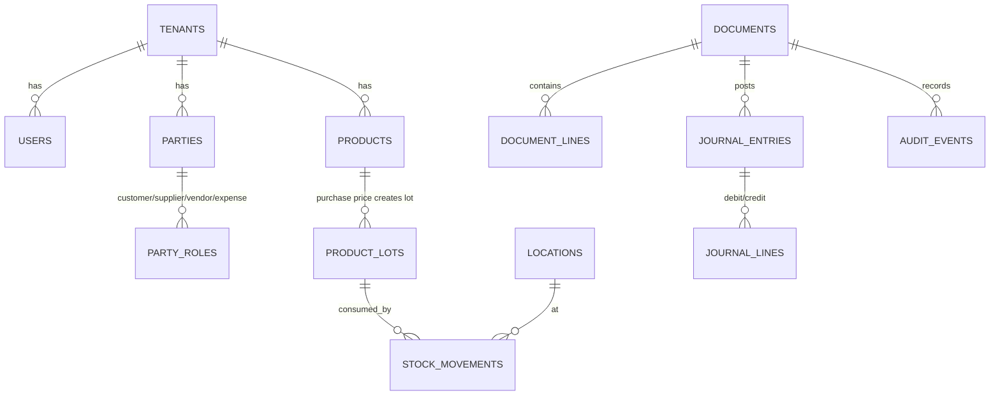

# 04 — Database Architecture

**V1 database:** PostgreSQL 16 + Drizzle (D-14)
**Future:** SQLite via the same repository interfaces (deferred)

Every rule here is written so the same schema shape works on both engines. That is why there are no Postgres-only column types in business tables.

---

## 1. Identifiers

**All primary keys are ULIDs, generated in application code.**

```
id  CHAR(26) PRIMARY KEY      -- e.g. 01JBXK7Q2N8YZ3M4P5R6S7T8V9
```

| Why | Reason |
|---|---|
| Generated client-side | An offline device must create valid IDs before it ever reaches the server |
| Time-sortable | Index locality without a separate created_at index |
| No autoincrement | Two writers would collide; sequences do not survive sync |
| Same on both engines | No `SERIAL` / `AUTOINCREMENT` divergence |

Never expose a sequential number as a public identifier. User-facing document numbers are a separate concern (§7).

---

## 2. Tenancy

**Every business table has `tenant_id CHAR(26) NOT NULL`.** No exceptions, including in single-tenant on-premise deployments (D-22).

```sql
tenant_id CHAR(26) NOT NULL REFERENCES tenants(id)
```

Rules:

1. `tenant_id` is resolved from `TenantContext` — **never** read from a request body, query string, or URL.
2. Every index on a business table starts with `tenant_id`.
3. Every unique constraint includes `tenant_id`.
4. PostgreSQL **Row Level Security is enabled** on all business tables as a second line of defence. Application scoping is the first; RLS catches the forgotten `WHERE`.

```sql
ALTER TABLE sales ENABLE ROW LEVEL SECURITY;
CREATE POLICY tenant_isolation ON sales
  USING (tenant_id = current_setting('app.tenant_id')::char(26));
```

The API sets `app.tenant_id` at the start of every transaction. RLS is not a substitute for scoped queries — it is the net under the tightrope (R-08).

---

## 3. Money and Quantity

**Money is stored as an integer in minor units.** Quantity is stored as a scaled integer.

| Concept | Storage | Scale | Example |
|---|---|---|---|
| Money | `BIGINT` | 2 (poisha) | `৳1,250.75` → `125075` |
| Quantity | `BIGINT` | 3 | `2.5 pcs` → `2500` |
| Unit cost | `BIGINT` | 4 | `৳12.3456` → `123456` |

Unit cost carries **4 decimal places**, not 2. FIFO consumption of fractional quantities at a 2-decimal unit cost accumulates rounding error across thousands of movements. The extra two places cost nothing and remove an entire class of drift.

Rules:

1. **No `FLOAT`, `REAL`, or `DOUBLE` anywhere in the schema.** SQLite has no decimal type, so float would guarantee divergence between online and offline (R-05).
2. `NUMERIC`/`DECIMAL` is also banned — SQLite lacks it. Integers only.
3. All arithmetic goes through `Money` / `Qty` helpers in `shared-utils`.
4. Currency is BDT-only in V1, but every money column is paired with the tenant's currency setting. Do not add a per-row currency column yet.

### Rounding (D-31)

- Rounding mode is **half-up**, applied **once**, at the point a value is stored or displayed.
- Never round intermediate calculations. Compute in the highest available scale, round at the boundary.
- Line total = round(qty × unit_price). Document total = sum of rounded line totals. Never round the sum of unrounded lines — the invoice must equal what the customer can add up by hand.

---

## 4. Standard Columns

Every business table:

```sql
id          CHAR(26)     PRIMARY KEY,
tenant_id   CHAR(26)     NOT NULL,
created_at  TIMESTAMPTZ  NOT NULL,
updated_at  TIMESTAMPTZ  NOT NULL,
created_by  CHAR(26)     NOT NULL,
updated_by  CHAR(26)     NOT NULL,
version     INTEGER      NOT NULL DEFAULT 1,
deleted_at  TIMESTAMPTZ  NULL,
deleted_by  CHAR(26)     NULL
```

Transactional documents additionally carry:

```sql
business_date  DATE      NOT NULL,   -- tenant-local date the transaction belongs to
entry_mode     TEXT      NOT NULL,   -- ON_TIME | LATE_ENTRY | BACKDATED | CORRECTED
status         TEXT      NOT NULL,   -- DRAFT | POSTED | VOIDED
operation_id   CHAR(26)  NOT NULL    -- idempotency key
```

### business_date vs created_at (D-29)

This distinction is the foundation of backdating, period lock, and Daybook.

| Column | Meaning | Used for |
|---|---|---|
| `business_date` | The date the transaction **belongs to** | All reports, ledgers, Daybook, period lock, profit |
| `created_at` | The instant the row was **written** | Audit only |

Timezone rule: **store `TIMESTAMPTZ` in UTC, compute `business_date` in the tenant's timezone (`Asia/Dhaka` default).** A sale at 00:30 Dhaka time belongs to that day's business date, not the previous UTC day. Getting this wrong shifts an entire day's takings into the wrong report and is very hard to detect after the fact.

---

## 5. Soft Delete and Immutability

| Data class | Delete behaviour |
|---|---|
| Draft document | Hard delete permitted (D-03) |
| Posted document | Void/reverse + `deleted_at` set. **Never** hard-deleted |
| Stock movement | Append-only. Never updated, never deleted |
| Journal line | Append-only. Never updated, never deleted |
| Audit event | Append-only. No delete path exists in code |
| Master data (product, party) | Soft delete if referenced; hard delete only if never used |

Corrections create **new** rows referencing the original (`reverses_id`, `corrects_id`). The history of what was believed at each point in time must remain reconstructable.

---

## 6. Core Table Groups



### 6.1 Party model (D-04)

One `parties` table. Roles are flags in `party_roles`, not separate tables.

```sql
parties(id, tenant_id, name, phone, address, ...)
party_roles(id, tenant_id, party_id, role)   -- CUSTOMER | SUPPLIER | VENDOR | EXPENSE | EMPLOYEE
```

- Phone uniqueness applies **only to the CUSTOMER role** (D-02): unique on `(tenant_id, phone)` where a CUSTOMER role exists. Other roles may share a number.
- Ledger views filter by role. A party who is both customer and supplier appears in both ledgers with the same underlying journal.

### 6.2 Inventory (D-05, D-17)

**Physical issue and valuation are separate concerns and must not share a code path.**

```sql
stock_movements(id, tenant_id, product_id, location_id, lot_id,
                qty, direction, business_date, source_doc_id, unit_cost, ...)
```

- Quantity and lots are tracked by **Product + Location** from day one, even though V1 exposes a single default location.
- Physical issue order: FIFO (or expiry-first) — decides *which lot leaves*.
- Valuation method (FIFO / Average): a **setting** — decides *what cost is reported*.
- Negative stock (D-19): movement is written with `cost_is_provisional = true` using last known cost. When real cost arrives, a **true-up journal entry** is posted. The original movement is never edited.

### 6.3 Posting kernel (A1)

Every financial effect posts to `journal_entries` / `journal_lines` (double-entry) **behind** the simple ledger UI. Users never see debits and credits unless they ask; the system always has them.

```sql
journal_lines(id, tenant_id, entry_id, account_id, party_id,
              debit_minor, credit_minor, business_date, ...)
```

**Invariant INV-01: every journal entry sums to zero.** Enforced in domain code and asserted in CI.

---

## 7. Document Numbering (D-30)

User-facing numbers are separate from ULIDs.

```
INV-2026-000123
{prefix}-{year}-{sequence}
```

Rules:

1. Sequence is per `(tenant_id, doc_type, year)`.
2. Allocated **inside** the document's transaction, from a `numbering_counters` row locked with `SELECT ... FOR UPDATE`. No gaps under concurrency, no duplicates.
3. A `device_prefix` column is reserved now (empty in V1). When offline devices can write, their numbers become `INV-D2-2026-000123` — this prevents duplicate numbers without a schema change later (A11).
4. Voided numbers are **not** reused. A gap in the sequence is normal and auditable; reuse is not.

---

## 8. Concurrency (D-32)

| Scenario | Mechanism |
|---|---|
| Two users edit the same document | Optimistic lock on `version`; second save fails with `CONFLICT_STALE_VERSION` |
| Two sales consume the same lot | Pessimistic `SELECT ... FOR UPDATE` on the lot rows, ordered by lot id to prevent deadlock |
| Document number allocation | `SELECT ... FOR UPDATE` on the counter row |
| Cash session close while a sale is in flight | Session state check inside the same transaction |

Lot consumption **must** use pessimistic locking. Optimistic retry on stock leads to oversell under POS load, and oversold stock in a hardware shop means a customer paid for something that is not there.

---

## 9. Indexing Baseline

Every business table:

```sql
CREATE INDEX ON <table> (tenant_id, business_date DESC);
CREATE INDEX ON <table> (tenant_id, status) WHERE deleted_at IS NULL;
```

Specific:

| Need | Index |
|---|---|
| POS product search | `pg_trgm` GIN on `(brand || ' ' || name)`, tenant-scoped |
| Barcode scan | unique `(tenant_id, barcode)` |
| Invoice lookup by phone | `(tenant_id, phone)` on parties |
| Ledger statement | `(tenant_id, party_id, business_date)` on journal_lines |
| Stock on hand | `(tenant_id, product_id, location_id, lot_id)` on movements |

Pagination is **keyset**, never `OFFSET`. Offset pagination degrades as transaction history grows, which is exactly when a shop cares (R-14).

---

## 10. Migrations

1. **Forward-only.** No down-migrations. Rollback is restore-from-backup.
2. **Additive by default.** Adding a nullable column is safe; dropping or renaming is not.
3. To remove a column: stop writing it → deploy → verify → drop in a later release.
4. Every migration runs inside a transaction.
5. Schema version is stored in the database; the application **refuses to start** if the DB schema is newer than the app (see `11_DEPLOYMENT_STRATEGY.md` §8.1).
6. Reserved-now columns (A10): `location_id`, `tax_rate_id`, `tax_amount`, `is_tax_inclusive`, `pack_size`, `credit_limit`, `device_prefix`. Adding these later would touch every transaction table.

---

## 11. Golden Invariants (CI-enforced)

Asserted on every commit touching money or stock. A failure blocks the merge.

| ID | Invariant |
|---|---|
| INV-01 | Every journal entry sums to zero (Σ debit = Σ credit) |
| INV-02 | Stock on hand = Σ movements, for every product/location/lot |
| INV-03 | No lot has negative remaining qty unless negative stock is enabled |
| INV-04 | Σ lot remaining qty = product on-hand qty per location |
| INV-05 | Inventory valuation = Σ (lot remaining × lot unit cost) |
| INV-06 | Party ledger balance = Σ journal lines for that party |
| INV-07 | Cash balance = opening + Σ in − Σ out for the session |
| INV-08 | Voided document has zero net effect on stock and journal |
| INV-09 | Every posted document has ≥ 1 journal entry |
| INV-10 | Every report figure reconciles to journal or movements — reports never compute from documents directly |

INV-10 is the one that prevents the classic ERP failure where the dashboard and the ledger disagree and nobody can say which is right.
