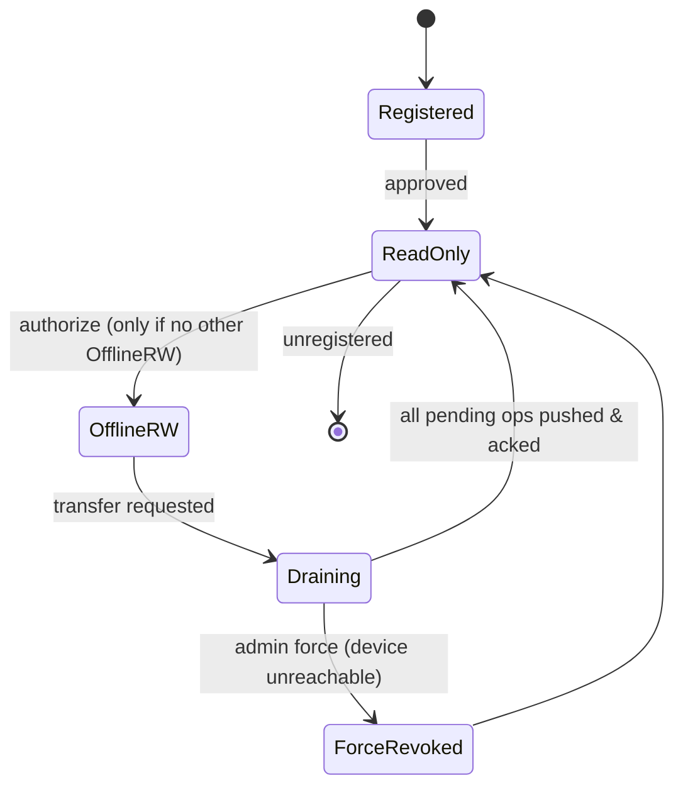
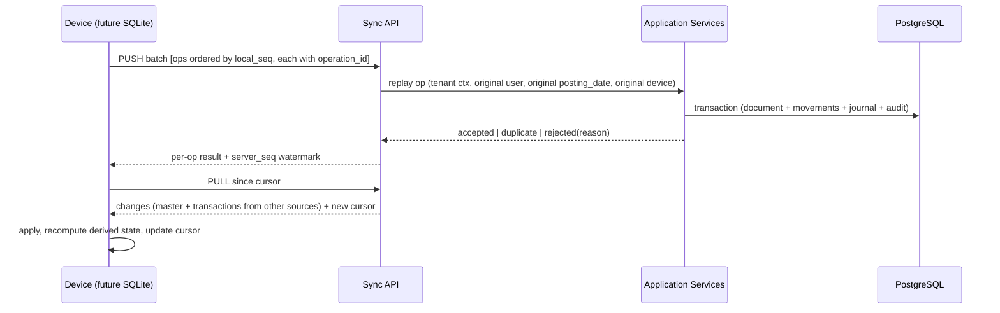

# 08 — Future Offline & Synchronization Architecture

> Wire-format details are in `SYNC_PROTOCOL.md`. This document is the model and the rules.

## 1. Scope and Final Direction

The SRS says one device has offline read/write and other devices are read-only "when the tenant's offline mode policy requires it". That leaves the central question unanswered: **while the offline device is disconnected, may the cloud accept writes for the same tenant?**

| Option | Description | Consequence |
|---|---|---|
| **A. Single-writer tenant (RECOMMENDED for V1)** | While `offline_mode = ON`, the designated device is the only writer for transactional data. All other clients (web/mobile) are read-only for transactional writes; master data edits are still allowed on the server and flow down. | No transactional conflicts by construction. Matches SRS §4.2 literally. Simple, safe, testable |
| B. Dual-writer with partitioned scope | Server writes allowed for documents the offline device never touches (e.g. different location/register) | Needs a strict partition key; feasible only after multi-location |
| C. Free dual-writer with conflict resolution | Both write everything | Stock/ledger conflicts are unavoidable and cannot be auto-resolved without violating SRS §5.4 |

**Final direction:** V1 is online-first with Drizzle + PostgreSQL. V1 temporary browser offline support uses IndexedDB. The full SQLite-based offline/synchronization architecture described below is a future phase. When implemented, D-01 single-writer authority applies unless a later decision changes it.

## 2. Device Authority State Machine

- Uniqueness enforced by `CREATE UNIQUE INDEX ON device_authorizations(tenant_id) WHERE capability='OFFLINE_RW' AND status='ACTIVE'`.
- **Force revoke** (device lost/broken) must be possible and must be loud: server marks the old device revoked; if that device ever reconnects, its outbox is imported into a **quarantine** review queue rather than applied blindly.
- Every state change is an audit event with actor, reason, timestamps (SRS §4.3).

## 3. Data Classification

| Class | Examples | Sync direction | Conflict policy |
|---|---|---|---|
| Platform | plans, permission registry | Server → device (read-only) | Server wins |
| Tenant master | products, parties, settings, roles, locations | Bidirectional (server authoritative) | Field-level last-writer-wins **with** a change report; server wins on ties; unique-key conflicts quarantined |
| Transactional | sales, purchases, payments, returns, expenses, adjustments, sessions | Device → server (append-only) | **No merge.** Documents are immutable facts; corrections are new documents |
| Derived | stock balances, party balances, report models | Recomputed on each side, never synced | N/A |
| Audit | audit events | Device → server, append-only | Never merged, never deleted |
| Sequences | invoice numbers | Device-prefixed ranges | Impossible to collide |

**Rule: the server never trusts device-computed totals, costs or balances. It re-executes the operation through the same application services and compares outcomes.**

## 4. Sync Engine Shape

### Push rules
- Ordered by `local_seq` per device; a failed op **blocks its dependents** (same aggregate) but not unrelated ops (dependency declared via `depends_on[]`).
- Idempotent by `operation_id` (ULID). Replay returns the original result.
- Batch size adaptive (e.g. 100 ops), resumable, ack per op.

### Pull rules
- Cursor = server-assigned monotonic `server_seq`; pull is `WHERE tenant_id=? AND server_seq > cursor ORDER BY server_seq LIMIT n`.
- Tombstones for deletes; soft-deletes carry `deleted_at`.
- Snapshot bootstrap for initial download / device transfer: server produces a consistent point-in-time export + starting cursor.

## 5. Conflict Taxonomy & Handling (SRS §5.4 — never silently overwrite)

| Conflict | Example | Handling |
|---|---|---|
| Duplicate operation | Retry after timeout | Idempotency → return original result |
| Stale master edit | Product price edited on both sides | Field-level merge, server wins on same field, both versions in audit, entry in "sync review" list |
| Unique key clash | Two customers with same phone created in both places | Quarantine → user chooses merge/keep-both-with-edit |
| Referenced entity missing | Sale references a product deleted on server | Reject op → quarantine with a fix action (restore product / edit sale) |
| Business rule violation on replay | Negative stock now disallowed; permission revoked; period closed | Reject → quarantine; **never force-post** |
| Late-arriving backdated document | Offline sale for a date already reported | Accept, flag `LATE ENTRY`, trigger recompute of affected period + reconciliation review |
| Device authority overlap | Revoked device reconnects with pending ops | Quarantine all, admin decides per-document |

Quarantined items live in `sync_conflicts` with: payload, reason, suggested action, and an explicit resolve endpoint. **Nothing is discarded automatically.**

## 6. Costing Under Future Sync (high risk)

Offline sales consume lots and compute COGS locally. When those sales arrive at the server *after* other transactions, FIFO/AVG order may differ.

Policy for the future full offline implementation:
1. Cost is computed **at replay time on the server** using the server's lot state ordered by `posting_date, created_at, id` — the server's number is authoritative.
2. If the server's computed cost differs from the device's, the difference is posted as a `COST_TRUE_UP` journal line and reported in a "Cost adjustments after sync" report — never silently discarded.
3. The device recomputes its local costing after each pull to converge.
4. Under single-writer mode (D-01 = A) divergence only occurs with backdated server-side corrections, which are already flagged.

## 7. Future SQLite Backup / Restore / Transfer

| Flow | Steps |
|---|---|
| Offline backup | Encrypt local SQLite → `tenant_device.sherbak` (AES-256-GCM + manifest + schema version + last cursor) |
| Clean reinstall | Install Tauri → start local NestJS/Node process → import backup → verify manifest + tenant ownership → restore → **resume sync from stored cursor** (pending outbox preserved) |
| Device transfer | Drain old device → snapshot from server → authorize new device → new device downloads snapshot → old device becomes read-only (audited) |
| Force transfer | Admin revokes; new device authorized from server snapshot; old device's later ops land in quarantine |

## 8. Observability (SRS §5.3)

`GET /sync/status` and a desktop UI panel showing: last successful push/pull, pending op count, failed op count, quarantined count, current cursor, schema versions, license status, estimated drift. Also a "Sync health" report for support.

## 9. Failure Matrix (must be tested)

| Failure | Expected behaviour |
|---|---|
| Network drop mid-push | Resume from last acked op; no duplicates |
| Server 500 mid-batch | Retry with backoff; partial acks preserved |
| Device clock wrong | Server records `created_at` server-side; device timestamps kept as `device_created_at` for audit |
| Local DB corruption | Detect on startup, restore from last backup, replay outbox |
| Schema mismatch | Refuse sync with actionable message + forced update path |
| Duplicate `operation_id` different payload | Reject as `IDEMPOTENCY_MISMATCH`, quarantine |
| Two devices claim OFFLINE_RW | Server rejects the unauthorized one; audit alert |
