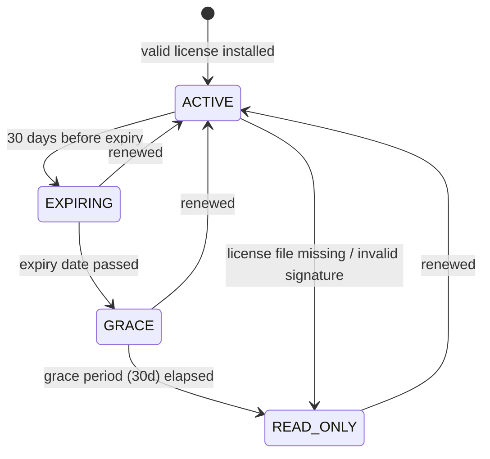

# 11 — Deployment Strategy

**Status:** FINAL for V1 · Governs D-21, D-22, D-23, D-24
**Applies from:** Phase 1 (interfaces) · Phase 14 (packaging)

---

## 1. Core Rule

> **One codebase. One build artifact. Deployment mode is configuration, never a code fork.**

SherERP is sold in two deployment modes. Both run the identical NestJS application, the identical Vue frontend, and the identical PostgreSQL schema. Signup, OTP, and subscription are **disabled by configuration — never deleted**.

Creating a separate on-premise branch or a stripped-down build is forbidden. With 31 modules and a non-programmer owner working through AI coding agents, a second codebase means every bug fix and every feature is implemented twice, diverges within weeks, and becomes unmaintainable. This is recorded as risk **R-25**.

---

## 2. Deployment Modes

| | **SaaS (V1 primary)** | **On-Premise (contract sales)** | **Standalone Desktop** |
|---|---|---|---|
| Hosting | SherERP cloud | Customer's own server | Customer's single PC |
| Database | PostgreSQL (shared, multi-tenant) | PostgreSQL (single tenant) | SQLite |
| Tenants | Many | Exactly one | One |
| Signup | Public | Disabled (installer seeds) | n/a |
| Identity | Phone OTP (D-07) | Seeded admin + password (D-21) | n/a |
| Entitlement | Subscription (M03) | Signed license key (D-23) | License key |
| Offline | Browser IndexedDB (temporary) | Not needed — server is on their LAN | Full |
| Commercial | Monthly/annual subscription | Term license + annual maintenance | Term license |
| **V1 availability** | ✅ Yes | ✅ Yes | ❌ **Deferred** |

### 2.1 Why Standalone Desktop is not available in V1

Per D-01 and D-14, V1 uses Drizzle + PostgreSQL only. The full SQLite offline implementation and the Tauri local-process model (D-20) are deferred to a future phase. Browser IndexedDB support in V1 is a **temporary connectivity bridge**, not a disconnected product.

**Do not sell a standalone single-PC install before the SQLite phase completes.**

### 2.2 On-Premise solves the connectivity problem today

Bangladesh internet and electricity instability is the original driver for offline support. An on-premise LAN server addresses this **without** waiting for the SQLite phase: the server sits inside the shop, staff PCs reach it over local network, and internet outage is irrelevant because nothing leaves the building.

This makes on-premise the practical single-business offering for V1.

---

## 3. On-Premise Architecture

```
┌──────────────── Customer premises (no internet required) ─────────────────┐
│                                                                            │
│   Staff PC ──┐                                                             │
│   Staff PC ──┼── LAN ──►  ┌──────────────────────────────────┐             │
│   POS PC   ──┘            │  Customer server / mini PC       │             │
│   Tablet   ──┘            │                                  │             │
│                           │  ┌────────┐  Nginx               │             │
│                           │  │ nginx  │  TLS + Vue static    │             │
│                           │  └───┬────┘                      │             │
│                           │      │                           │             │
│                           │  ┌───▼────┐  NestJS API          │             │
│                           │  │  api   │  SINGLE_TENANT_MODE  │             │
│                           │  └───┬────┘                      │             │
│                           │      │                           │             │
│                           │  ┌───▼────┐  PostgreSQL          │             │
│                           │  │   db   │  internal network    │             │
│                           │  └────────┘  only                │             │
│                           │                                  │             │
│                           │  ┌────────┐  nightly .sherdb     │             │
│                           │  │ backup │  encrypted export    │             │
│                           │  └────────┘                      │             │
│                           └──────────────────────────────────┘             │
└────────────────────────────────────────────────────────────────────────────┘
```

Four containers via Docker Compose: `nginx`, `api`, `db`, `backup`.

### 3.1 Critical frontend requirement

The Vue application **must read its API base URL at runtime**, not at build time.

```
// WRONG — bakes the URL into the bundle, forcing a custom build per customer
const API = import.meta.env.VITE_API_URL

// RIGHT — one bundle works everywhere
const cfg = await fetch('/config.json').then(r => r.json())
const API = cfg.apiBaseUrl
```

Nginx serves `/config.json` generated at container start. If the URL is baked in, every on-premise customer needs their own frontend build, and the "one artifact" rule collapses immediately.

---

## 4. Configuration Flags

```env
# ---- Deployment mode ----
SINGLE_TENANT_MODE=true          # D-22: seed tenant, disable registration routes
IDENTITY_VERIFIER=none           # D-21: none | otp
ENTITLEMENT_SOURCE=license       # D-23: license | subscription
LICENSE_KEY_PATH=/etc/sher/license.key

# ---- Disabled subsystems ----
SMS_PROVIDER=none                # M29 SMS wallet off
BILLING_ENABLED=false            # M03 subscription off

# ---- Tenant seed (used once at first boot) ----
SEED_TENANT_NAME="Rahman Hardware"
SEED_ADMIN_PHONE="+8801XXXXXXXXX"
SEED_ADMIN_PASSWORD_INIT="<random, forced change at first login>"

# ---- Infrastructure ----
DATABASE_URL=postgresql://sher:CHANGE_ME@db:5432/sher
BACKUP_PASSWORD=<customer-controlled, D-15>
BACKUP_SCHEDULE="0 2 * * *"
```

### 4.1 Boot-time validation (mandatory)

The application must **refuse to start** on an invalid combination:

| Invalid combination | Reason |
|---|---|
| `SINGLE_TENANT_MODE=false` + `IDENTITY_VERIFIER=none` | SaaS with no identity verification — critical security failure |
| `ENTITLEMENT_SOURCE=license` + no readable license file | Ambiguous entitlement state |
| `SINGLE_TENANT_MODE=true` + `BILLING_ENABLED=true` | Contradictory mode |

Fail loudly at boot. A silently misconfigured deployment is far worse than a server that will not start.

---

## 5. License Key

### 5.1 Format

A signed JWT (EdDSA / Ed25519), validated **offline** against a public key embedded in the application. No phone-home — this is a core selling point for a security-motivated customer.

```json
{
  "iss": "sher-erp",
  "sub": "lic_01JBXK2Q4N7YZ",
  "tenant": { "id": "01JBXK...", "name": "Rahman Hardware" },
  "customer": { "name": "Rahman Hardware Ltd", "contact": "+8801XXXXXXXXX" },
  "term": { "issued": "2026-09-01", "expires": "2031-09-01", "years": 5 },
  "limits": { "users": 15, "locations": 3 },
  "modules": ["core","pos","purchase","inventory","ledger","reports","warranty"],
  "grace_days": 30,
  "support_until": "2027-09-01"
}
```

Note `term.expires` (license) and `support_until` (maintenance) are **separate fields** — see §8.2.

### 5.2 Validation rules

1. Signature verified against embedded public key at every boot and once daily thereafter.
2. Private signing key lives **only** on the SherERP release machine, never in the repo, never in the shipped image.
3. `modules[]` feeds the existing Settings module — it does **not** create a second feature-flag system.
4. `limits.users` is enforced as a **warning first, block on exceed** — consistent with D-11's warning-only philosophy for credit limits.
5. Validation failure never crashes the app. It drops to `READ_ONLY` (D-24).

### 5.3 On DRM realism

A determined customer with root on their own server can bypass any license check. Do not over-invest here. The purpose of the license key is to keep honest customers honest and to create a natural renewal conversation. **The contract is the real enforcement mechanism.**

---

## 6. License Expiry — State Machine



| State | Transactions | Reports | Backup export | User sees |
|---|---|---|---|---|
| `ACTIVE` | ✅ | ✅ | ✅ | Nothing |
| `EXPIRING` | ✅ | ✅ | ✅ | Persistent renewal banner |
| `GRACE` | ✅ | ✅ | ✅ | Blocking warning at each login |
| `READ_ONLY` | ❌ | ✅ | ✅ | Renewal-required notice |

### 6.1 Non-negotiable rule

**There is no state in which the customer loses access to their own data.**

Backup export (`.sherdb`, D-15) works in every state including `READ_ONLY`. A shop locked out of its own sales ledger because a renewal invoice was paid late is a lawsuit, a destroyed reputation, and — for an accounting system — arguably a regulatory problem. The `READ_ONLY` behaviour must be written into the sales contract so it is never a surprise.

---

## 7. Installation

### 7.1 Prerequisites (state these in the sales agreement)

| Requirement | Minimum | Recommended |
|---|---|---|
| OS | Ubuntu 22.04 LTS / Windows Server + Docker | Ubuntu 22.04 LTS |
| CPU / RAM | 2 core / 4 GB | 4 core / 8 GB |
| Disk | 60 GB SSD | 120 GB SSD |
| Network | Static LAN IP | Static LAN IP + VLAN |
| **UPS** | **Required** | Required |

The UPS is not optional. PostgreSQL survives sudden power loss, but repeated hard shutdowns during electricity instability will eventually corrupt something, and the customer will blame the software.

### 7.2 Install sequence

```bash
tar xzf sher-onprem-v1.0.0.tar.gz && cd sher-onprem
cp .env.example .env && nano .env      # set tenant name, admin phone, backup password
cp ~/license.key ./secrets/license.key
./install.sh
```

`install.sh` performs, in order:

1. Verify Docker + Compose present, ports free, disk space sufficient
2. Validate license signature — **abort if invalid**, before touching anything
3. Generate TLS certificate (self-signed, or import customer CA cert)
4. Start `db`, wait for healthy
5. Run schema migrations
6. `SeedTenantProvisioner` — create the single tenant from the license key (idempotent; refuses if a tenant exists)
7. Create admin user with `must_change_password = true`
8. Start `api`, `nginx`, `backup`
9. Run health check; print LAN URL and one-time admin credentials
10. **Immediately take baseline backup** and verify it restores

### 7.3 First-login flow (on-premise)

```
Admin opens https://<lan-ip>
   ↓
Login: seeded phone + one-time password   ← no OTP (D-21 NoOpIdentityVerifier)
   ↓
Forced password change
   ↓
Backup password confirmation + written acknowledgement of D-15 unrecoverability
   ↓
Business setup wizard (M01) → opening balances (A13) → go live
```

---

## 8. Updates and Maintenance

This is the **largest ongoing cost** of on-premise sales. Plan it before selling, not after.

### 8.1 Update mechanics

No push deploys. Every customer can be on a different version.

**Required safeguards:**

1. **Forward-only migrations.** No destructive down-migrations. Rollback = restore from the pre-upgrade dump.
2. **Automatic pre-migration dump.** The upgrade script takes a full `pg_dump` before any schema change, and aborts if the dump fails.
3. **Version compatibility gate.** The app refuses to start if the DB schema version is *newer* than the application — prevents a botched partial upgrade from running silently against mismatched data.
4. **Version support window.** Support the current major and one previous. Publish this. Otherwise a five-year license implicitly obligates you to five years of back-porting.

```bash
./upgrade.sh v1.4.0
# → validate license still active
# → pg_dump to ./backups/pre-upgrade-<ver>-<ts>.sql   (abort on failure)
# → docker compose pull
# → run migrations
# → health check
# → auto-rollback to dump if health check fails
```

### 8.2 Commercial structure — license vs maintenance

**Sell these separately.** This is the single most important commercial decision for a 5-year term.

| Component | What it buys | Billing |
|---|---|---|
| **License** (1 or 5 yr) | Right to run the software for the term | One-time, per term |
| **Maintenance & Support** | Updates, patches, support response | **Annual**, ~18–22% of license value |

A 5-year license *with* support bundled means SherERP is obligated to support a 2026 stack in 2031 — through multiple Node, PostgreSQL, and Drizzle major versions — for zero additional revenue. Separating them means a customer may decline maintenance, keep running their existing version, and renew later.

**Recommendation for early customers:** 1-year auto-renewing. Predictable, low commitment on both sides, and it limits exposure while V1 stabilises.

### 8.3 Support without visibility

You cannot see their logs, their database, or their screen. Build the **diagnostic bundle export** in Phase 14 — a one-click admin action producing a zip containing:

- Application + container logs (last 7 days)
- App version, schema version, license state
- Configuration with **all secrets redacted**
- Row counts per table, DB size, slow-query summary
- Health-check results

Without this, every support ticket degrades into a phone call with a non-technical shopkeeper. This single feature will save more support hours than anything else on this page.

---

## 9. Security Posture

Be precise with the customer about the division of responsibility. A security-motivated buyer will ask, and vagueness here creates liability.

| SherERP provides | Customer is responsible for |
|---|---|
| Data never leaves their network | OS patching and firewall |
| No third-party cloud dependency | Physical server access |
| Offline license validation (no phone-home) | TLS certificate renewal |
| TLS enabled by default | Backups actually running and being **tested** |
| PostgreSQL bound to internal Docker network only | Safeguarding the backup password |
| Forced admin password change at first login | LAN segmentation / Wi-Fi security |
| Audit logging on by default (M27) | UPS and power stability |

### 9.1 Hardened defaults

- PostgreSQL **never** binds to `0.0.0.0` — internal Docker network only, no host port mapping
- Nginx: TLS 1.2+, HSTS, security headers
- Generated secrets are random per install — no shared default credentials across customers
- Audit logging cannot be disabled by configuration
- `tenant_id` scoping and PostgreSQL RLS remain active even with one tenant (R-08)

### 9.2 The backup password warning (D-15)

Backups use a **customer-controlled** password. If it is lost and server-managed recovery was not enabled, the data is **permanently unrecoverable**. This must be:

1. Acknowledged in writing at contract signing
2. Confirmed again in the first-login wizard
3. Repeated in the printed handover document

---

## 10. CI — Both Modes Must Be Tested

The on-premise path will silently rot if it is not exercised on every commit. An AI agent will eventually introduce an OTP or subscription dependency into a shared path, and nobody will notice until an install fails at a customer site months later.

**Required CI gates:**

| Gate | Assertion |
|---|---|
| `saas-smoke` | Boot with SaaS flags → signup works → OTP called → subscription entitlement resolves |
| `onprem-smoke` | Boot with on-prem flags → seed tenant created → `POST /auth/register` returns **404** → license entitlement resolves → admin logs in without OTP |
| `invalid-config` | `SINGLE_TENANT_MODE=false` + `IDENTITY_VERIFIER=none` → **boot refused** |
| `license-states` | Each D-24 state transition produces correct behaviour; **backup export succeeds in `READ_ONLY`** |
| `boundary-check` | No module outside M02 imports an SMS provider or `EntitlementProvider` implementation |

---

## 11. Definition of Done — Deployment Mode

- [ ] `IdentityVerifier`, `TenantProvisioner`, `EntitlementProvider` interfaces exist in `core-application`; implementations live in infrastructure only
- [ ] Frontend reads API base URL from runtime `/config.json`
- [ ] Boot-time config validation rejects every invalid combination in §4.1
- [ ] License key signature validated offline; private key absent from repo and image
- [ ] All four D-24 states implemented; backup export verified working in `READ_ONLY`
- [ ] `install.sh` idempotent; aborts cleanly on invalid license before mutating anything
- [ ] `upgrade.sh` takes pre-migration dump and auto-rolls-back on failed health check
- [ ] Diagnostic bundle export implemented with secrets redacted
- [ ] All five CI gates in §10 passing
- [ ] Manual acceptance: full install on a clean VM → business setup → 10 real transactions → backup → wipe → restore → figures match exactly
- [ ] Contract template covers `READ_ONLY` on expiry, backup-password unrecoverability, support window, and prerequisites

---

## 12. Sales Constraint

**Cap on-premise customers at 2–3 until V1 is stable.**

Each on-premise install multiplies support surface: a different OS, a different network, a different version, and no remote visibility. SherERP is owned by a non-programmer relying on AI coding agents. Two or three reference customers provide the validation and the revenue; a dozen provides an unmanageable support load that will stall development of the remaining modules.

Take the first customers close to home — ones you can physically visit.
