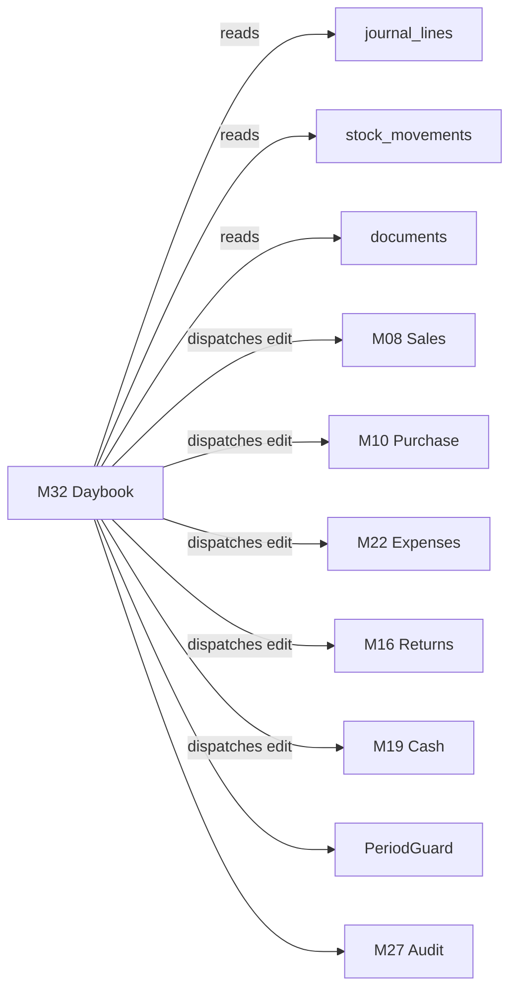

# M32 — Daybook

**Phase:** 9 (with Reports) · **Decision:** D-27 · **Depends on:** M08, M09, M10, M16, M17, M18, M19, M22, M24, M27

---

## 1. Purpose

Daybook is the shop owner's **day-end review screen**. It shows every transaction that happened in a date range, on one page, and allows correcting any of them without navigating to each module separately.

At the end of the day the owner opens Daybook, reviews everything that happened, fixes mistakes, and prints a physical copy for the shop's records.

**What Daybook is not:** a second transaction engine. It does not create documents, does not compute balances, and does not implement its own edit logic. Every action it offers calls the owning module's existing use case.

---

## 2. Requirements

| # | Requirement |
|---|---|
| R1 | Show all transactions for a date range, default = today |
| R2 | Date range picker: from-date and to-date |
| R3 | Show sales, purchases, payments received, payments made, expenses, returns, cash movements, bank movements, stock adjustments |
| R4 | Edit, update, or delete/void any listed transaction **from this screen** |
| R5 | Print a physical day-end report |
| R6 | The printed report shows opening state, the day's transactions, and closing state |
| R7 | Filter by transaction type, party, user, payment method |
| R8 | Show running cash position through the day |
| R9 | Respect all permissions, period locks, and audit rules identically to the source modules |

---

## 3. Dependencies

Daybook is a **read aggregator + action dispatcher**. It owns no transactional tables of its own.



---

## 4. Database Entities

**No new transactional tables.** Two supporting tables only:

```sql
daybook_prints(
  id, tenant_id,
  from_date, to_date,
  printed_at, printed_by,
  opening_cash_minor, closing_cash_minor,
  transaction_count,
  totals_json,          -- snapshot of the printed figures
  reprint_of_id NULL    -- set when reprinting
)

daybook_review_marks(
  id, tenant_id,
  business_date,
  reviewed_at, reviewed_by,
  note
)
```

`daybook_prints` exists so a reprint can be proven identical to — or explicitly different from — the original physical copy. In a paper-driven shop this matters: two different printouts of "the same day" with different numbers, and no record of why, is exactly the dispute Daybook is meant to prevent.

---

## 5. Reading Model

Daybook reads from the **posting kernel**, not from each module's document tables.

```sql
SELECT ... FROM journal_lines jl
JOIN journal_entries je ON ...
WHERE jl.tenant_id = $1
  AND je.business_date BETWEEN $2 AND $3
ORDER BY je.business_date, je.created_at, je.id
```

**Why journal, not documents.** Reading each module's tables separately means Daybook can disagree with the ledger — the exact failure INV-10 forbids. Reading the journal guarantees Daybook shows what the books actually say.

Stock-only events (reconciliation, transfers) that produce no journal entry are unioned in from `stock_movements`.

---

## 6. Domain Rules

| # | Rule |
|---|---|
| DR1 | Daybook contains **no** business logic. Every mutation delegates to the owning module's use case |
| DR2 | Rows are ordered by `business_date`, then `created_at`, then `id` — stable and reproducible |
| DR3 | Filtering is always on `business_date`, never `created_at` (D-29) |
| DR4 | Voided documents are shown, struck through, with their reversal linked — not hidden |
| DR5 | A transaction whose `business_date` is in a locked period is **read-only**, with a lock icon and the reason (D-25) |
| DR6 | Opening cash = closing cash of the previous business date. Mismatch is shown as a visible discrepancy, never silently reconciled |
| DR7 | Backdated entries appear on their `business_date`, tagged `BACKDATED`, and are also listed in the "entered today, belongs elsewhere" section |

DR7 is what makes Daybook trustworthy under this project's backdating freedom. Without it, an owner reviewing today's page would never see that someone entered a transaction dated last week.

---

## 7. Application Services

| Service | Purpose |
|---|---|
| `GetDaybookService` | Fetch entries for a range with filters, paginated |
| `GetDaybookSummaryService` | Totals, opening/closing cash, counts by type |
| `MarkDayReviewedService` | Record that the owner reviewed a date |
| `PrintDaybookService` | Produce the print payload and record a `daybook_prints` row |
| *(edits)* | **None.** Dispatched to `UpdateSaleService`, `VoidSaleService`, `UpdatePurchaseService`, `UpdateExpenseService`, etc. |

The absence of edit services here is the module's most important design property. If a future change adds `DaybookUpdateSaleService`, the module has become a back door and the review has failed.

---

## 8. API Endpoints

```
GET  /api/v1/daybook?from=2026-08-15&to=2026-08-15&type=&partyId=&userId=&cursor=
GET  /api/v1/daybook/summary?from=&to=
POST /api/v1/daybook/review          { businessDate, note }
POST /api/v1/daybook/print           { from, to }
GET  /api/v1/daybook/prints?from=&to=
```

Edits use the **existing** module endpoints (`PATCH /sales/{id}`, `POST /sales/{id}/void`, …). Daybook adds no mutation endpoints for business documents.

---

## 9. Permissions

| Code | Meaning |
|---|---|
| `daybook.view` | See the Daybook |
| `daybook.view.all_users` | See other users' transactions (without it, only own) |
| `daybook.review.mark` | Mark a day reviewed |
| `daybook.print` | Print the day-end report |

**Editing from Daybook requires the source module's own permission** — `sales.invoice.void` to void a sale, and so on. Daybook grants no editing rights of its own. This is the central security property of the module: it concentrates *visibility*, never *authority*.

Cost and profit columns obey `inventory.cost.view` / `report.profit.view` and are omitted from the response body when not permitted (07 §7).

---

## 10. UI Screens

**Main screen**

```
┌────────────────────────────────────────────────────────────────┐
│ Daybook      [From: 15/08/2026] [To: 15/08/2026]  [Today ▾]    │
├────────────────────────────────────────────────────────────────┤
│ Opening Cash ৳12,500   In ৳45,200   Out ৳8,300   Closing ৳49,400│
├────────────────────────────────────────────────────────────────┤
│ Filters: [All types ▾] [All parties ▾] [All users ▾]           │
├──────┬────────┬──────────┬─────────┬────────┬────────┬────────┤
│ Time │ Type   │ No.      │ Party   │ Amount │ Method │ Actions│
├──────┼────────┼──────────┼─────────┼────────┼────────┼────────┤
│ 09:12│ Sale   │INV-…0123 │ Karim   │  2,500 │ Cash   │ ✎  ⊘   │
│ 10:05│ Purchase│PUR-…0045│ Rahim Tr│ 18,000 │ Due    │ ✎  ⊘   │
│ 11:30│ Expense│EXP-…0012 │ Belal   │  5,000 │ Cash   │ ✎  ⊘   │
│ 14:20│ Sale   │INV-…0124 │ Walk-in │  1,200 │ bKash  │ ✎  ⊘   │
│ ~~15:40 Sale  INV-…0125   Jamal      3,000   Cash  VOIDED~~    │
├──────┴────────┴──────────┴─────────┴────────┴────────┴────────┤
│ ⚠ 2 backdated entries made today belong to other dates  [show] │
├────────────────────────────────────────────────────────────────┤
│           [Mark Reviewed]   [Print Day-End Report]             │
└────────────────────────────────────────────────────────────────┘
```

Editing opens the **source module's** editor in a drawer — the same form, the same validation, the same permissions. Not a Daybook-specific form.

---

## 11. Print Layout (R5, R6)

The printed report contains, in order:

1. **Header** — shop name, address, date range, printed at/by, print serial from `daybook_prints`
2. **Opening state** — cash in hand, bank balances, total receivable, total payable
3. **Transaction list** — every transaction, chronological, with number, party, amount, method, user
4. **Section totals** — sales, purchases, receipts, payments, expenses, returns
5. **Closing state** — cash, bank, receivable, payable
6. **Movement summary** — opening → closing with the net change per account
7. **Backdated section** — entries recorded in this range but dated outside it, and entries dated in this range but recorded outside it
8. **Footer** — signature lines, page numbers, `REPRINT` watermark when applicable

Section 7 satisfies the owner's requirement that "all transactions before and after are also mentioned in the final print file". Without it, a printed day-end report can be silently invalidated by a later backdated entry.

Output is PDF, A4, printable on a thermal 80mm roll in a condensed variant.

---

## 12. Validation

| Rule | Behaviour |
|---|---|
| `to_date` before `from_date` | Reject |
| Range > 92 days | Reject — use Reports for longer periods |
| Future `to_date` | Allowed (shows nothing), no error |
| Print with zero transactions | Allowed — a zero day is a meaningful record |

---

## 13. Audit

- Every edit or void performed via Daybook is audited by the **source module**, with `source: DAYBOOK` recorded in the audit event.
- `MarkDayReviewed` writes its own audit event.
- Every print writes a `daybook_prints` row; reprints set `reprint_of_id` and carry a `REPRINT` watermark.

Recording `source: DAYBOOK` matters: when a figure is later disputed, it distinguishes "corrected during day-end review" from "changed weeks later", which are very different acts.

---

## 14. Reports

Daybook feeds one report — the day-end sheet in §11. It defines no other reporting figures; all totals come from the journal, so Daybook and the financial reports cannot disagree (INV-10).

---

## 15–16. Offline / Sync

Daybook is read-mostly and derives everything from the journal. When the future offline phase lands, it works unchanged on the local dataset. No Daybook-specific sync entities exist.

---

## 17. Testing

| ID | Test |
|---|---|
| T1 | Range returns exactly the transactions with `business_date` in range |
| T2 | Daybook totals equal the Reports module totals for the same range (INV-10) |
| T3 | Opening cash = previous day's closing cash |
| T4 | Voided transactions appear struck through with reversal linked |
| T5 | Locked-period rows are read-only; edit attempt returns `PERIOD_LOCKED` |
| T6 | Backdated entry appears on its `business_date` **and** in the backdated section |
| T7 | Editing a sale from Daybook produces an audit event identical to editing from Sales, plus `source: DAYBOOK` |
| T8 | Cashier without `daybook.view.all_users` sees only own transactions |
| T9 | Cashier response body contains no cost or profit field |
| T10 | Cross-tenant: tenant B's transactions never appear |
| T11 | Reprint records `reprint_of_id` and carries the watermark |
| T12 | Timezone: a 00:30 Dhaka sale appears on that day, not the previous |

---

## 18. Manual Scenarios (pre-written expected numbers)

**S-DB-01 — Normal day**

```
Opening cash ৳10,000
Sale INV-001    ৳2,500 cash
Purchase PUR-001 ৳8,000 cash
Expense EXP-001 ৳1,000 cash (salary to Belal)
Sale INV-002    ৳3,000 due

Expected: 4 rows · cash in ৳2,500 · cash out ৳9,000
          closing cash ৳3,500 · receivable +৳3,000
Daybook closing cash MUST equal Cash Report closing cash.
```

**S-DB-02 — Void from Daybook**

```
Void INV-001 from Daybook.
Expected: row struck through · closing cash ৳1,000
          stock returned · customer ledger cleared
          audit event source = DAYBOOK
```

**S-DB-03 — Backdated entry**

```
On 15 Aug, enter a purchase dated 10 Aug.
Expected: 15 Aug Daybook shows it in the backdated section, NOT in the main list
          10 Aug Daybook shows it in the main list, tagged BACKDATED
          If July is locked and the date were 10 Jul → PERIOD_LOCKED
```

**S-DB-04 — Print integrity**

```
Print 15 Aug. Add a backdated 15 Aug entry. Reprint.
Expected: reprint shows the new entry, carries REPRINT watermark,
          references the original print serial, totals differ visibly.
```

---

## 19. Edge Cases

| Case | Behaviour |
|---|---|
| Day with zero transactions | Show empty state with opening = closing; printing allowed |
| Transaction edited while another user views | Optimistic lock → `CONFLICT_STALE_VERSION`, refresh prompt |
| Range spanning a period lock boundary | Locked rows read-only, open rows editable, in one list |
| Very large day (POS, 500+ rows) | Keyset pagination; summary computed server-side, never from the loaded page |
| Cash session still open at print time | Print allowed, marked `SESSION OPEN — provisional` |

---

## 20. Security

- Every query tenant-scoped; RLS active.
- Daybook grants **no** editing authority of its own (§9).
- Cost/profit omitted from the response body, not hidden client-side.
- Print payloads are generated server-side; the client cannot request figures it may not see.

---

## 21. AI / MCP Readiness

`GetDaybookService` and `GetDaybookSummaryService` are exposed as read-only MCP tools ("what happened in the shop today?"). **No Daybook mutation tool is exposed** — AI-initiated edits go through the owning module's tools with their own permission checks.

---

## 22. Definition of Done

- [ ] Gates 1–4 of `DEFINITION_OF_DONE.md` pass
- [ ] T1–T12 pass
- [ ] S-DB-01 → S-DB-04 manually verified with pre-written numbers
- [ ] **Daybook totals equal Reports totals** for 5 random ranges (INV-10)
- [ ] No mutation endpoint or edit service exists in M32
- [ ] Printed PDF verified on A4 and on 80mm thermal
- [ ] Backdated section verified against a real backdated entry
