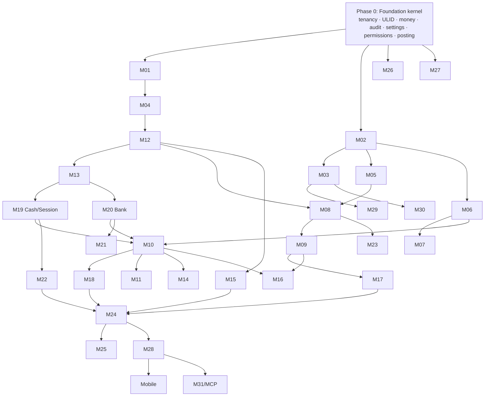

# Module Dependency Map (31 Modules)

## 1. Dependency Table

> Offline class describes the future full SQLite/Tauri offline target. V1 uses PostgreSQL online; temporary browser offline support uses IndexedDB.

| # | Module | Hard depends on | Soft/later depends on | Offline class |
|---|---|---|---|---|
| 01 | Business/Tenant Setup | — | 03, 26 | Read + limited edit |
| 02 | Auth, Users, Roles, Permissions | 01 | 03, 29(SMS/OTP) | Local login for cached users |
| 03 | Subscription & Entitlements | 01, 02 | 29, 30 | Read-only (license) |
| 04 | Product & Catalog | 01, 02, 26 | 13, 23 | Full |
| 05 | Customer | 01, 02 | 17 | Full |
| 06 | Supplier | 01, 02 | 18 | Full |
| 07 | Vendor/Consignment | 06, 03(entitlement) | 12, 18 | Full |
| 08 | Sales & POS | 04, 05, 12, 13, 19, **posting kernel** | 07, 23, 26 | Full |
| 09 | Sales Invoice & Payments | 08, 17, 19, 20 | 29 | Full |
| 10 | Purchase | 04, 06, 12, 13, 18, 19, 20 | 14 | Full |
| 11 | Purchase Orders | 10 | — | Full |
| 12 | Inventory & Stock | 04, **posting kernel** | 13, 15 | Full |
| 13 | Inventory Lots & Costing | 12, 26 | 14 | Full |
| 14 | Landed Cost | 10, 13 | — | Full |
| 15 | Stock Reconciliation | 12, 13 | 27 | Full |
| 16 | Returns | 08, 09, 10, 12, 13, 17, 18 | 23 | Full |
| 17 | Customer Ledger | 05, **posting kernel** | 09, 16 | Full |
| 18 | Vendor/Supplier Ledger | 06, 07, **posting kernel** | 10, 16 | Full |
| 19 | Cash & POS Sessions | 02, **posting kernel** | 08, 22 | Full |
| 20 | Bank Accounts | **posting kernel** | 09, 10, 22 | Full |
| 21 | Bank Reconciliation | 20, 27 | 22 | Deferred (online-first) |
| 22 | Expenses | 19, 20, 05/06 (party), **posting kernel** | 26 | Full |
| 23 | Warranty | 04, 08, 10, 16 | — | Full |
| 24 | Reports | all transactional modules | 26 | Full (local data scope) |
| 25 | Dashboard | 24, 02 | — | Full |
| 26 | Settings & Feature Controls | 01, 02, 03 | all | Read + limited |
| 27 | Audit | 02 | all | Full (append-only) |
| 28 | Future Offline & Sync | all transactional modules | 30 | Future |
| 29 | Documents, Notifications, SMS | 08, 09, 03 | 30 | Printing full; SMS online-only |
| 30 | SaaS, Multi-tenancy, Backup | 01, 02, 03, 27 | 28 | Local backup/restore only |
| 31 | Technical Quality, API, AI Readiness | cross-cutting | — | — |

## 2. Graph

## 3. Circular Dependency Analysis

| Apparent cycle | Reality | Resolution |
|---|---|---|
| Sales ↔ Customer Ledger | Ledger is a projection of journal lines, not a writer | Posting kernel owns writes; ledger is read-side. **No cycle** |
| Purchase ↔ Lots/Costing | Purchase creates lots; costing reads lots | One-way: purchase → StockService → lots |
| Returns ↔ Sales/Purchase | Returns reference originals | One-way reference |
| Settings ↔ everything | Every module reads settings | Settings has no dependency on modules. **No cycle** |
| Subscription ↔ every gated module | Modules call `EntitlementService` | Interface built in Phase 0 with a permissive stub → real implementation in Phase 10. **Cycle broken by interface** |
| Audit ↔ everything | Audit only appends | No cycle |
| Sync ↔ every module | Sync replays through services | Sync depends on modules, never the reverse; modules only emit outbox records via a Phase-0 interface |

**Conclusion: no true circular dependencies, provided Entitlement, Audit, Settings, Outbox and Posting are Phase-0 interfaces.** That is the single most important sequencing insight in this plan.

## 4. Change vs the SRS-suggested Order

| Change | Reason |
|---|---|
| Settings (26) + Audit (27) move from late to **Phase 1** | Retrofitting audit and a settings registry into posted transactions requires rewriting every service |
| Cash (19) + Bank (20) move **before** Purchase/Sales payments | A payment must credit/debit a real cash or bank account; otherwise payments are rebuilt twice |
| Purchase (10) implemented **before** Sales/POS (08) | Stock must exist before it can be sold; purchase exercises lots + costing + supplier ledger + cash first, giving an earlier end-to-end proof |
| Ledgers (17, 18) are **not separate build steps** but read models delivered with Purchase and Sales | They are projections; building them as separate modules duplicates logic |
| Subscription (03) full implementation moves **later**, interface earlier | Avoids blocking core ERP work on billing decisions |
| Bank Reconciliation (21) moves after Reports | Depends on stable bank transactions and a correction/audit story |
| **Daybook (32) added as a new module in Phase 9** (D-27) | Confirmed day-end review requirement with no prior owner. Reads from the journal and dispatches edits to the owning modules — it holds no transactional tables and no edit logic of its own |

## Module 32 — Daybook

| # | Module | Depends on | Depended on by | Offline class |
|---|---|---|---|---|
| 32 | Daybook | 08, 09, 10, 16, 17, 18, 19, 22, 24, 27 | — | Full (read-derived) |

Daybook is a **read aggregator + action dispatcher**. It must never gain a mutation service; editing from Daybook calls the source module's use case so permissions, period lock (D-25) and audit behave identically. Spec: `32_DAYBOOK.md`.
