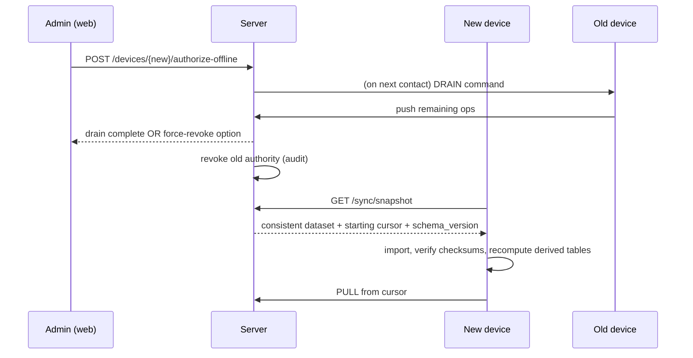

# Sync Protocol (Wire Contract)

Companion to `08_OFFLINE_SYNC_ARCHITECTURE.md`. This protocol defines the future full SQLite/Tauri offline synchronization model. V1 temporary browser offline support uses IndexedDB and does not require this full sync protocol.

## 1. Identifiers

| Field | Meaning |
|---|---|
| `operation_id` | ULID generated by the device per mutation. Idempotency key. Never reused |
| `local_seq` | Monotonic integer per device; defines device-side order |
| `server_seq` | Monotonic bigint assigned by the server; the pull cursor |
| `device_id` | ULID assigned at device registration |
| `schema_version` | Integer; both sides must be within the supported window |
| `entity_version` | Per-row optimistic version for master data |

## 2. Envelope

```jsonc
// PUSH request
{
  "device_id": "01J...",
  "schema_version": 42,
  "license_token": "...",
  "operations": [
    {
      "operation_id": "01J...",
      "local_seq": 1187,
      "type": "sale.create",              // = application service command name
      "payload": { /* the exact command DTO, zod-validated */ },
      "context": {
        "user_id": "01J...",
        "posting_date": "2026-08-12",
        "device_created_at": "2026-08-12T11:04:07Z",
        "permissions_snapshot_hash": "sha256:..."
      },
      "depends_on": ["01J..."],           // operation_ids that must succeed first
      "client_result_digest": "sha256:..."// device-computed totals for cross-check
    }
  ]
}
```

```jsonc
// PUSH response
{
  "results": [
    { "operation_id": "01J...", "status": "APPLIED", "server_seq": 90211,
      "server_result_digest": "sha256:...", "divergence": null },
    { "operation_id": "01J...", "status": "DUPLICATE", "server_seq": 90180 },
    { "operation_id": "01J...", "status": "QUARANTINED",
      "reason_code": "PERIOD_CLOSED", "conflict_id": "01J..." },
    { "operation_id": "01J...", "status": "BLOCKED", "reason_code": "DEPENDENCY_FAILED" }
  ],
  "server_watermark": 90215
}
```

```jsonc
// PULL request  →  GET /sync/pull?cursor=90180&limit=500
// PULL response
{
  "changes": [
    { "server_seq": 90181, "entity": "product", "op": "UPSERT",
      "id": "01J...", "entity_version": 7, "data": {...} },
    { "server_seq": 90182, "entity": "sale", "op": "UPSERT", "id": "01J...", "data": {...} },
    { "server_seq": 90183, "entity": "party", "op": "TOMBSTONE", "id": "01J...", "deleted_at": "..." }
  ],
  "next_cursor": 90183,
  "has_more": true,
  "server_time": "2026-08-14T09:00:00Z"
}
```

## 3. Status Codes

| Status | Meaning | Device action |
|---|---|---|
| `APPLIED` | Server executed the operation through application services | Mark synced, store `server_seq` |
| `DUPLICATE` | `operation_id` already applied | Mark synced (no re-apply) |
| `QUARANTINED` | Rejected by a business rule/permission/period/conflict | Keep locally, show in "Needs attention" |
| `BLOCKED` | A `depends_on` operation did not apply | Retry after dependency resolution |
| `IDEMPOTENCY_MISMATCH` | Same id, different payload | Hard error, quarantine, alert |
| `SCHEMA_INCOMPATIBLE` | Version window violated | Stop sync, prompt update |
| `AUTHORITY_REVOKED` | Device no longer holds OFFLINE_RW | Stop pushing; all pending → quarantine review |

## 4. Server-Side Replay Rules

1. Set tenant context to the operation's tenant; **actor = original user**; `device_id` recorded.
2. Re-check entitlement → permission → settings → period status **at replay time**. Failure ⇒ `QUARANTINED` (never force).
3. Execute the same application service the online API would.
4. Recompute costs/totals server-side. Compare with `client_result_digest`:
   - equal → done;
   - different → apply server values, record `COST_TRUE_UP`/`AMOUNT_DIVERGENCE` entry + report row (never silently drop).
5. Assign `server_seq`, write audit event with `source='SYNC'`, `device_created_at` preserved.
6. All of the above in one DB transaction per operation.

## 5. Ordering Guarantees

- Per device: strict `local_seq` order.
- Cross-entity dependencies are explicit (`depends_on`); the server does not infer them.
- Backdated documents are allowed (subject to period lock) and marked `LATE ENTRY`; any affected recompute is scheduled after the batch.

## 6. Bootstrap & Transfer Snapshot



Snapshot contents: tenant settings, users/roles/permissions, parties, products/brands/categories/units, locations, open lots + balances **as movements**, open documents, ledger opening positions (a "carry-forward" journal entry rather than the entire history), and the last N months of transactions per policy.

**Rule: the device receives an opening-position journal entry, not necessarily the full history, so a device restore is bounded in size while balances stay exact.**

## 7. Conflict Records

```jsonc
{ "conflict_id":"01J...","tenant_id":"...","device_id":"...","operation_id":"...",
  "reason_code":"UNIQUE_PHONE_CLASH","entity":"party","payload":{...},
  "server_state":{...},"suggested_actions":["MERGE","KEEP_BOTH_EDIT","DISCARD_WITH_REASON"],
  "status":"OPEN","resolved_by":null,"resolved_at":null,"resolution_note":null }
```

Resolution endpoint: `POST /sync/conflicts/{id}/resolve` — every resolution is audited; `DISCARD_WITH_REASON` requires a destructive permission.

## 8. Numbering Under Sync

`numbering_series` has `device_prefix`. Offline device issues `INV-D2-000123`; server issues `INV-S-000456`. No renumbering on sync (renumbering would break printed customer copies). Series format is tenant-configurable but the prefix component is mandatory when offline mode is enabled.

## 9. Sync Test Matrix (must all pass before Phase 12 exit)

| # | Scenario | Expectation |
|---|---|---|
| SY-01 | 500 ops clean push | All APPLIED, digests match |
| SY-02 | Repeat the same batch | All DUPLICATE, no data change |
| SY-03 | Network killed at op 250 | Resume, no duplicates, no gaps |
| SY-04 | Server restart mid-batch | Same as SY-03 |
| SY-05 | Op references deleted product | QUARANTINED with fix action |
| SY-06 | Period closed on server | QUARANTINED, not force-posted |
| SY-07 | User permission revoked while offline | QUARANTINED |
| SY-08 | Device cost differs from server cost | Applied with true-up entry + report row |
| SY-09 | Revoked device reconnects with 200 ops | All quarantined, admin review |
| SY-10 | Schema version too old | SCHEMA_INCOMPATIBLE, no partial writes |
| SY-11 | Master data edited both sides | Field-level merge + review entry, no silent loss |
| SY-12 | Full offline business day vs equivalent online day | Identical stock, ledger, cash, report totals |
